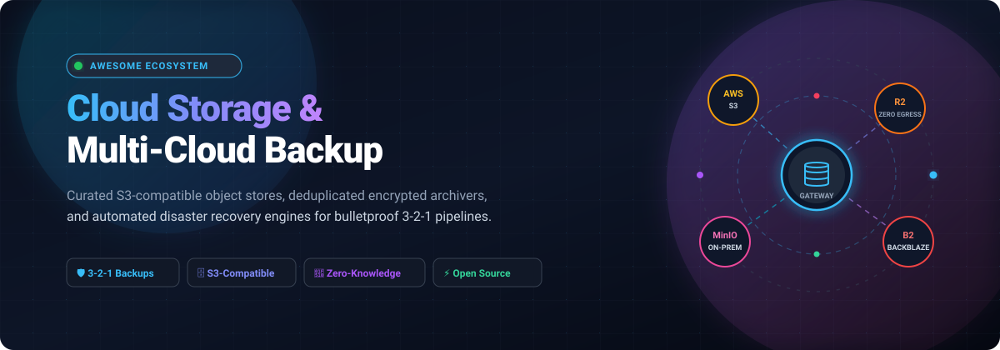

  

# ☁️ Awesome-Cloud-Storage-Multi-Cloud-Backup 💾

  
  
  
  
  
  

  <strong>Curated Directory of Cloud Object Storage (S3-Compatible), Multi-Cloud Backup Engines, Deduplicated Encrypted Archivers &amp; Disaster Recovery Orchestrators</strong> 
  <em>Designed for Sysadmins, DevOps / SRE Engineers, Homelab Builders, Cloud Architects &amp; Security Teams</em>

---

## 📑 Table of Contents

- [📊 Sector Overview & Market Dynamics](#-sector-overview--market-dynamics)
- [🏢 SaaS & Hosted Cloud Storage Platforms](#-saas--hosted-cloud-storage-platforms)
- [💻 Open-Source GitHub Projects](#-open-source-github-projects)
- [💡 Production Architectures & 3-2-1 Backup Strategy](#-production-architectures--3-2-1-backup-strategy)
- [🤝 How to Contribute](#-how-to-contribute)
- [💖 Support & Sponsorship](#-support--sponsorship)
- [⭐ Star History](#-star-history)
- [⚠️ Disclaimer](#️-disclaimer)

---

## 📊 Sector Overview & Market Dynamics

The global cloud storage and multi-cloud backup market is valued at over **$130 billion** and projected to expand at a **~20–23% CAGR** well past **$350–$400 billion** by the 2030s, fueled by exponential growth in unstructured enterprise data, stringent ransomware immutability mandates, and multi-petabyte AI/ML training datasets.

Market structure exhibits **high concentration** at the core infrastructure layer—commanded by an oligopoly of hyperscalers (**AWS**, **Microsoft Azure**, and **Google Cloud**) holding the vast majority of raw capacity and enterprise contracts. Simultaneously, a dynamic, **fragmented ecosystem** of alternative cloud providers (**Cloudflare R2**, **Wasabi**, **Backblaze B2**, **Scaleway**) and specialized zero-knowledge decentralized networks thrives by offering predictable pricing, zero egress fees, regional data sovereignty compliance (GDPR/NIS2), and developer-tailored APIs.

---

## 🏢 SaaS & Hosted Cloud Storage Platforms

The following SaaS and hosted object storage platforms are ranked in descending order by **Company Scale** (Market Capitalization / Enterprise Valuation / Annual Revenue):

| Company & Platform | Company Size (Market Cap / Valuation / Revenue) | Starting Pricing (Specific Tier) | Free Tier / Free Trial Limits | Key Features |
| :--- | :--- | :--- | :--- | :--- |
| **[Microsoft Azure Blob Storage](https://azure.microsoft.com/services/storage/blobs/)** | 📈 ~$3.6T Market Cap | `$0.018/GB/month` (Hot LRS Tier; Cool at `$0.010/GB/mo`, Cold at `$0.0036/GB/mo`, Archive at `$0.00099/GB/mo`) | 🎁 **12-Month Free Tier**: 5 GB LRS Hot Blob Storage per month with 20,000 reads & 10,000 writes/month, plus $200 free credit for first 30 days | Massively scalable Microsoft cloud object storage supporting hot, cool, cold, and archive tiers alongside immutable WORM policies and geo-redundant replication. |
| **[Google Cloud Storage (GCS)](https://cloud.google.com/storage)** | 📈 ~$3.2T Market Cap (Alphabet) | `$0.020/GB/month` (Standard storage tier in `us-central1`/`us-east1`; Nearline at `$0.010/GB/mo`, Coldline at `$0.004/GB/mo`, Archive at `$0.0012/GB/mo`) | 🎁 **Always Free**: 5 GB-months of Standard storage in select US regions (`us-central1`, `us-east1`, `us-west1`), 5,000 Class A ops, 50,000 Class B ops, and 100 GB egress/month | Unified multi-regional cloud object storage featuring Autoclass tiering, dual-region replication, and high-throughput analytics/backup pipelines. |
| **[Amazon S3 (AWS Simple Storage Service)](https://aws.amazon.com/s3/)** | 📈 ~$2.7T Market Cap (Amazon) | `$0.023/GB/month` (Standard tier, first 50 TB/month in US East; Glacier Flexible at `$0.0036/GB/mo`, Deep Archive at `$0.00099/GB/mo`) | 🎁 **12-Month Free Tier**: 5 GB S3 Standard storage, 20,000 GET requests, 2,000 PUT/POST/LIST requests, and 15 GB outbound data transfer per month | Industry-standard cloud object storage offering 99.999999999% (11 nines) durability, Object Lock immutability, cross-region replication, and Glacier archival tiers. |
| **[Cloudflare R2](https://www.cloudflare.com/products/r2/)** | 📈 ~$105B Market Cap | `$0.015/GB/month` (Standard storage; `$4.50` per million Class A mutation ops, `$0.36` per million Class B read ops; **$0.00/GB egress**) | 🎁 **Always Free**: 10 GB-months of standard storage, 1,000,000 Class A operations/month, 10,000,000 Class B operations/month, and unlimited 100% free egress bandwidth | Globally distributed, S3-compatible object storage featuring zero egress bandwidth fees and automatic edge caching for multi-cloud backups and assets. |
| **[DigitalOcean Spaces](https://www.digitalocean.com/products/spaces)** | 📈 ~$10B Market Cap | `$5.00/month` flat base plan (includes 250 GiB storage and 1 TiB outbound transfer; additional storage at `$0.02/GiB/mo`, additional egress at `$0.01/GiB`) | 🎁 **60-Day Free Trial**: $200 promotional credit for new accounts to evaluate platform infrastructure and storage services | Developer-friendly S3-compatible object storage bundled with a built-in CDN for simple application backups, static assets, and off-site snapshots. |
| **[Scaleway Object Storage](https://www.scaleway.com/en/object-storage/)** | 📈 ~€10.3B Parent Rev (Iliad Group) / ~€150M Scaleway Rev | `€0.00803/GB/month` (~`$0.0087/GB/mo` for Standard One Zone) or `€0.01606/GB/month` (~`$0.0174/GB/mo` for Standard Multi-AZ); requests free | 🎁 **90-Day Free Trial**: 750 GB free storage (split between Multi-AZ & One Zone) for new accounts; plus permanent 75 GB free egress per month and free API requests | European sovereign S3-compatible cloud storage offering multi-AZ resilience, Glacier cold storage, and GDPR-compliant EU data residency. |
| **[Wasabi Hot Cloud Storage](https://wasabi.com)** | 📈 ~$1.8B Private Valuation | `$7.99/TB/month` (`$0.00799/GB/month`, `$7.99/mo` minimum commitment for 1 TB; zero egress fees and zero API request fees) | 🎁 **30-Day Free Trial**: 1 TB of cloud object storage and up to 3 TB (3x) egress download bandwidth, no credit card required | High-speed, predictable-pricing S3-compatible cloud object storage with zero egress or API request fees and immutable bucket compliance. |
| **[Backblaze B2 Cloud Storage](https://www.backblaze.com/cloud-storage)** | 📈 ~$430M Market Cap (~$178M Rev) | `$6.95/TB/month` (`$0.00695/GB/month`; `$0.01/GB` egress beyond free allowance, free CDN egress to Cloudflare/Fastly) | 🎁 **Always Free**: 10 GB cloud storage forever, 3x monthly average storage volume in free egress (up to 30 GB/month), and free API transactions | High-value S3-compatible cloud object storage engineered for automated backups, media archives, and native integrations with Restic, rclone, Veeam, and Synology. |
| **[IDrive e2](https://www.idrive.com/e2/)** | 📈 ~$14M–$28M Estimated Annual Revenue (Bootstrapped Private) | `$6.00/TB/month` (`$0.006/GB/month` with 1 TB `$6/mo` minimum on pay-as-you-go; discounted annual plans available; free ingress & API calls) | 🎁 **Always Free**: 10 GB storage forever with free ingress, free API calls, and 3x free egress download allowance (30 GB/month), no credit card required | Fast, S3-compatible cloud object storage built for rapid backup, disaster recovery, and immutable object-locked cloud archives. |
| **[Storj (Distributed Cloud Object Storage)](https://www.storj.io)** | 📈 ~$7M Token Market Cap (Private Entity) | `$0.007/GB/month` (`$7.00/TB/month` for Globally Distributed Standard storage; `$0.007/GB` egress transfer) | 🎁 **30-Day Free Trial**: 25 GB free storage allotment and 2 free Object Mount licenses | Zero-trust, globally distributed S3-compatible object storage splitting encrypted erasure-coded file shards across thousands of independent storage nodes. |

---

## 💻 Open-Source GitHub Projects

The following open-source tools, distributed storage engines, and backup orchestrators are **strictly sorted in descending order by GitHub Star Count**. Beside each project name is a social star badge linking directly to that repository's stargazers page:

1. **[MinIO (`minio/minio`)](https://github.com/minio/minio)**   
   ⚡ High-performance, Kubernetes-native open-source S3-compatible object storage server in Go supporting erasure coding, bitrot protection, bucket replication, and Object Lock immutability.

2. **[rclone (`rclone/rclone`)](https://github.com/rclone/rclone)**   
   🔄 The definitive "Swiss Army knife" command-line utility for multi-cloud sync, copy, mount, and `crypt` client-side encryption supporting over 70 cloud storage providers.

3. **[Restic (`restic/restic`)](https://github.com/restic/restic)**   
   🔒 Flagship open-source backup program in Go featuring content-defined chunking deduplication, strong AES-256 encryption, snapshot verification, and native S3/B2/GCS/Azure/SFTP backends.

4. **[SeaweedFS (`seaweedfs/seaweedfs`)](https://github.com/seaweedfs/seaweedfs)**   
   🌊 Fast, scalable open-source distributed object store and filesystem in Go offering S3 API compatibility, billions of files management, cross-datacenter active-active replication, and cloud tiering.

5. **[Ceph (`ceph/ceph`)](https://github.com/ceph/ceph)**   
   🏛️ Massively scalable open-source distributed storage system providing object (RADOS Gateway with S3/Swift compatibility), block (RBD), and file (CephFS) storage for petabyte-scale clusters.

6. **[Duplicati (`duplicati/duplicati`)](https://github.com/duplicati/duplicati)**   
   🌐 Popular open-source backup client featuring a browser-based management UI, AES-256 encryption, block-level deduplication, and automated scheduling across S3, B2, WebDAV, and OneDrive.

7. **[Kopia (`kopia/kopia`)](https://github.com/kopia/kopia)**   
   ⚡ Fast, cross-platform open-source encrypted backup tool in Go offering both CLI and desktop/web GUIs, Zstd/LZ4 compression, content-defined deduplication, and native cloud object storage support.

8. **[BorgBackup (`borgbackup/borg`)](https://github.com/borgbackup/borg)**   
   🛡️ Battle-tested deduplicating archiver providing authenticated encryption, high-ratio compression, and mountable FUSE backup snapshots over SSH.

9. **[Rook (`rook/rook`)](https://github.com/rook/rook)**   
   ☸️ CNCF graduated cloud-native storage orchestrator for Kubernetes, turning distributed storage systems like Ceph into self-managing, self-scaling S3-compatible storage services.

10. **[Velero (`vmware-tanzu/velero`)](https://github.com/vmware-tanzu/velero)**   
    📦 Industry-standard open-source tool for backing up, restoring, and migrating Kubernetes cluster resources and persistent volumes across multi-cloud S3 object stores.

11. **[OpenEBS (`openebs/openebs`)](https://github.com/openebs/openebs)**   
    🧱 Leading open-source Container Attached Storage (CAS) solution for Kubernetes, providing persistent local and replicated block storage with multi-cloud snapshotting capabilities.

12. **[Longhorn (`longhorn/longhorn`)](https://github.com/longhorn/longhorn)**   
    🐮 CNCF incubating lightweight, reliable, and easy-to-use distributed block storage system for Kubernetes with built-in recurring snapshots and S3/NFS backup replication.

13. **[Backrest (`garethgeorge/backrest`)](https://github.com/garethgeorge/backrest)**   
    🖥️ Modern web UI and orchestrator wrapped around `restic` providing scheduled multi-repo backups, retention policies, health checks, and Discord/Slack/email alerts.

14. **[Garage (`deuxfleurs-org/garage`)](https://github.com/deuxfleurs-org/garage)**   
    🦀 Lightweight, self-hosted open-source geo-distributed S3-compatible object storage engine written in Rust, tailored for multi-site replication, homelabs, and low-resource servers.

15. **[pgBackRest (`pgbackrest/pgbackrest`)](https://github.com/pgbackrest/pgbackrest)**   
    🐘 Reliable, high-performance PostgreSQL backup and restore solution supporting multi-repo parallel backups, delta restores, and direct streaming to S3, GCS, and Azure.

16. **[WAL-G (`wal-g/wal-g`)](https://github.com/wal-g/wal-g)**   
    🗄️ Archival and point-in-time recovery (PITR) backup tool for PostgreSQL, MySQL, Redis, MongoDB, and FoundationDB directly to multi-cloud object storage.

17. **[Rustic (`rustic-rs/rustic`)](https://github.com/rustic-rs/rustic)**   
    🦀 Fast, standalone, memory-efficient backup tool in Rust fully compatible with Restic repository formats, supporting TOML profiles and cold/glacier backends.

18. **[Dragonfly (`dragonflyoss/Dragonfly2`)](https://github.com/dragonflyoss/Dragonfly2)**   
    🐉 Intelligent P2P-based image and large-file distribution system in cloud-native architectures that accelerates artifact and multi-gigabyte backup downloads across clusters.

19. **[Borgmatic (`borgmatic-collective/borgmatic`)](https://github.com/borgmatic-collective/borgmatic)**   
    ⚙️ Declarative YAML-driven wrapper for BorgBackup that automates file backups, database dumps (PostgreSQL, MySQL, SQLite, MongoDB), snapshot retention, and healthchecks.

20. **[Zenko CloudServer (`scality/cloudserver`)](https://github.com/scality/cloudserver)**   
    🌉 Open-source Node.js implementation of the Amazon S3 protocol, serving as a flexible multi-cloud object gateway across local disks, AWS S3, Google Cloud, and Azure.

21. **[Autorestic (`cupcakearmy/autorestic`)](https://github.com/cupcakearmy/autorestic)**   
    🧁 Config-driven CLI wrapper for Restic that orchestrates multiple backup locations to multiple cloud targets using simple YAML files.

22. **[Skykeep (`yashwanthkamireddi/skykeep`)](https://github.com/yashwanthkamireddi/skykeep)**   
    🚀 Open-source multi-cloud storage and backup utility engineered to simplify cross-provider cloud data management, synchronization, and resilient off-site preservation.

---

## 💡 Production Architectures & 3-2-1 Backup Strategy

Building resilient enterprise and homelab backup pipelines requires adhering to modern data protection standards:

* **The 3-2-1-1-0 Rule**:
  * **3 Copies of Data**: 1 primary production copy + 2 backup copies.
  * **2 Different Media Types**: e.g., NVMe/SSD local pool + cloud object storage.
  * **1 Off-Site Copy**: Stored in a geographically separate region or independent cloud provider.
  * **1 Immutable or Offline Copy**: Protected with S3 Object Lock (WORM compliance) or air-gapped cold storage against ransomware.
  * **0 Errors**: Verified by automated repository health checks (`restic check --read-data`, `kopia snapshot verify`).

### Recommended Stack Combinations:
* **Enterprise Kubernetes & Cloud-Native**: `Velero` + `MinIO` (on-prem) replicated to `Wasabi` or `Amazon S3` with Object Lock.
* **Server & Homelab 3-2-1 Pipeline**: `Restic` + `Backrest` (orchestrator) pushing deduplicated AES-256 snapshots to `Backblaze B2` primary and `Cloudflare R2` secondary (zero egress).
* **Database Disaster Recovery**: `pgBackRest` or `WAL-G` with continuous WAL streaming directly into S3-compatible buckets for Point-in-Time Recovery (PITR).

---

## 🤝 How to Contribute

Contributions are warmly encouraged! Help keep this ecosystem up-to-date:

1. 🍴 **Fork the repository**.
2. 🌿 **Create a descriptive feature branch** (`git checkout -b feature/add-new-storage-tool`).
3. 📝 **Add your tool**: Follow the table or list formatting (include pricing, free limits, company scale, or star badges).
4. ✅ **Ensure accuracy**: Verify links, pricing tiers, and open-source license information.
5. 🚀 **Submit a Pull Request** with a concise summary of the addition or change.

---

## 💖 Support & Sponsorship

If you find this curated list and multi-cloud backup architecture reference helpful:

- ⭐ **Star this repository** to help others discover it across GitHub!
- 🍴 **Fork & Share** it with your engineering team, DevOps community, or homelab peers on Reddit, LinkedIn, and X/Twitter.
- ☕ **Support my open-source work**: Sponsor the project via the [GitHub Sponsors Dashboard](https://github.com/sponsors/ishandutta2007) — offering tiers for profile badges, repository shoutouts, and prioritized issue requests!

  

---

## ⭐ Star History

---

## ⚠️ Disclaimer

- This repository is a **community-curated index** for educational and architectural reference — not a formal endorsement.
- Always retain and securely back up your repository encryption passwords (`Restic`, `Kopia`, `BorgBackup`, `rclone crypt`). If master keys are lost, data recovery is mathematically impossible.
- Periodically perform and document dry-run disaster recovery restorations to validate backup integrity.

---

  Maintained with ❤️ by <a href="https://github.com/ishandutta2007">Ishan Dutta</a> and the open-source cloud storage community.

